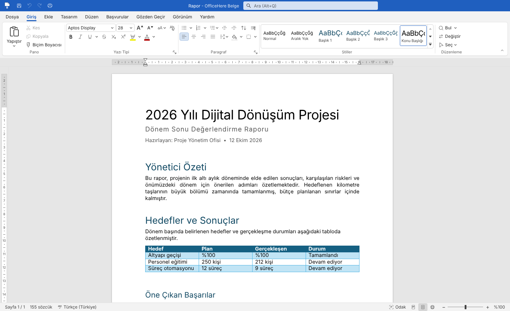
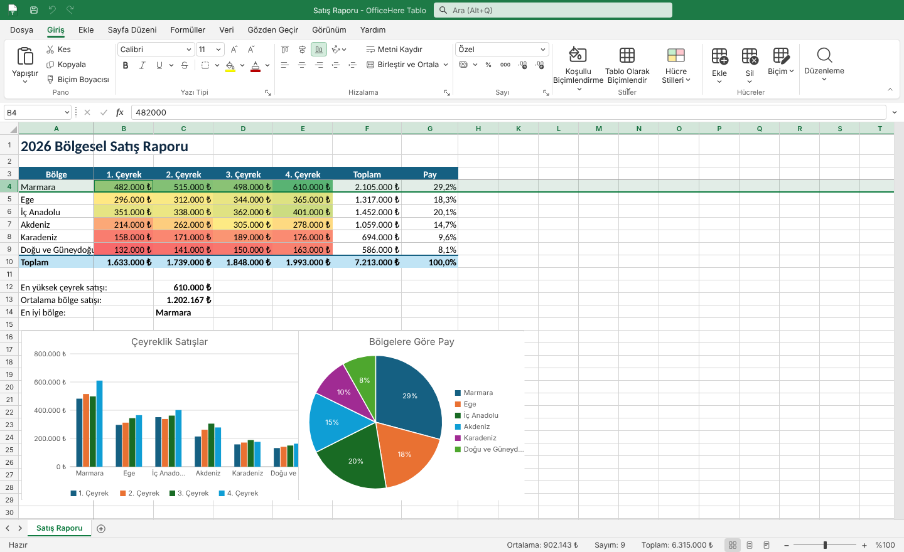
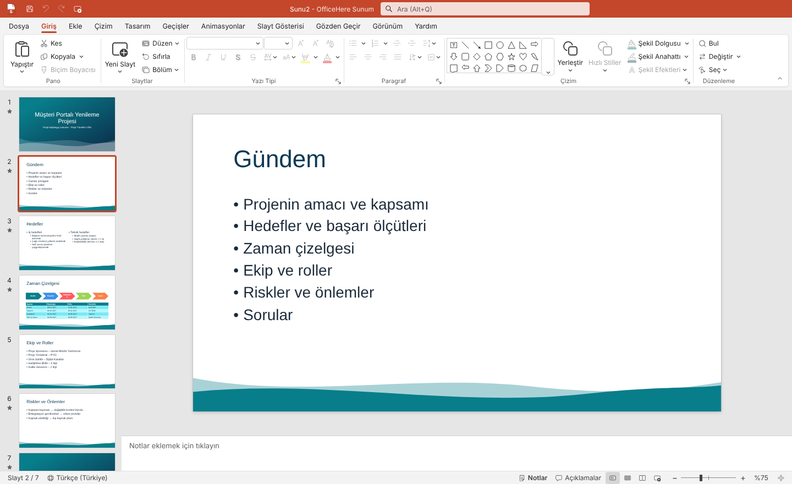
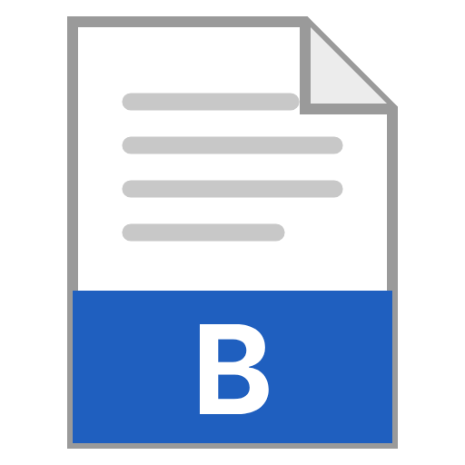

<div align="center">


# OfficeHere

**Açık kaynak, Türkçe, tanıdık ofis paketi.**
Belge, Tablo ve Sunum — `.docx`, `.xlsx`, `.pptx` başta olmak üzere OpenDocument (`.odt` `.ods` `.odp`),
eski 97-2003 (`.doc` `.xls` `.ppt`), RTF, Markdown ve CSV dosyalarını açar, düzenler ve kaydeder.

**Hesap yok · Reklam yok · Abonelik yok · Telemetri yok · Yapay zekâ yok.**
Belgeleriniz bilgisayarınızda kalır; uygulamanın ağa ne zaman çıktığı [aşağıda](#ağ-erişimi) tek tek yazılıdır ve ölçülür.

[İndir](https://github.com/fyildirim-debug/officehere/releases) ·
[Hukuki çerçeve](HUKUKI.md) ·
[Mimari](MIMARI.md) ·
[Katkı](KATKI.md)

</div>



<table>
<tr>
<td></td>
<td></td>
</tr>
<tr>
<td align="center">Tablo — koşullu biçimlendirme, grafikler, Türkçe formüller</td>
<td align="center">Sunum — temalar, slayt bölmesi, notlar</td>
</tr>
</table>

## Uygulamalar

| | Uygulama | Karşılığı | Dosyalar |
| --- | --- | --- | --- |
|  | **OfficeHere Belge** | Kelime işlemci | `.docx` `.docm` `.odt` `.rtf` `.md` `.html` `.txt` · açar: `.doc` `.dotx` `.dotm` `.ott` → PDF |
|  | **OfficeHere Tablo** | Hesap tablosu | `.xlsx` `.ods` `.csv` `.tsv` · açar: `.xls` `.xlsm` `.xltx` `.xltm` `.ots` `.html` → PDF, HTML |
|  | **OfficeHere Sunum** | Sunu | `.pptx` `.odp` `.ppsx` `.potx` · açar: `.ppt` `.pptm` `.potm` `.ppsm` `.otp` → PDF, PNG |

Üçü de aynı tanıdık düzeni paylaşır: renkli başlık çubuğu, Hızlı Erişim Araç
Çubuğu, sekmeli komut şeridi, Dosya görünümü, durum çubuğu ve yakınlaştırma.
Arayüz tamamen Türkçedir; Renkli, Beyaz, Koyu Gri ve Siyah temaları vardır.

### Belge

- Gerçek sayfa görünümü: A4/A3/A5/Letter/Legal, dikey/yatay, kenar boşlukları, sütunlar, bölümler
- Sayfalama (dul/yetim satır denetimi, birlikte tut), cetvel, üst/alt bilgi ve sayfa numarası
- Stil galerisi ve stil kümeleri, temalar, filigran, sayfa rengi ve kenarlığı
- Listeler ve çok düzeyli listeler, tablolar (birleştir/böl, tablo stilleri), resimler, şekiller, kapak sayfası, simgeler
- İçindekiler, dipnot ve son not, açıklamalar, değişiklikleri izleme (kabul/ret, değişiklik çubukları)
- Resim yazısı, çapraz başvuru, kaynakça (APA/IEEE), dizin, denklem, grafik, satır numaraları
- Metni kaydır, resim kırpma, Stiller bölmesi, sekme durakları, Otomatik Düzelt, mini araç çubuğu
- Adres mektup birleştirme (CSV/XLSX), belge karşılaştırma, düzenleme koruması
- Bul ve Değiştir (Türkçe İ/i, I/ı duyarlı), Anahat/Taslak/Okuma/Web görünümleri, ayrıntılı yazdırma ayarları
- Büyük İlk Harf, biçimli ve otomatik güncellenen tarih/saat, Simge (son kullanılanlar), Alt+X kod dönüşümü
- Sesli Oku (okunan sözcük vurgulanır, hız ve ses seçimi), Sözcük Sayısı (seçim istatistikleri)
- Numaralandırmaya yeniden başla / devam et / değer ayarla
- Bilinen klavye kısayolları, sağ tık menüleri, otomatik kurtarma ve çökme koruması

### Tablo

- 1.048.576 satır × 16.384 sütunluk akıcı ızgara, bölmeleri dondurma, sayfa sekmeleri
- 370'ten fazla işlev; **Türkçe işlev adları** (`=TOPLA(A1:A10)`, `=EĞER(…;…;…)`, `=DÜŞEYARA`) ve İngilizce adlar birlikte
- Formül çubuğu, renkli başvuru vurguları, F4, otomatik tamamlama, doldurma tutamacıyla seriler
- Hücreleri Biçimlendir, sayı biçimleri (₺, %, tarih), koşullu biçimlendirme, tablo ve hücre stilleri
- Tablo olarak biçimlendirme ve yapısal başvurular (`=TOPLA(Tablo1[Tutar])`), Özet Tablo, Dilimleyici
- Sıralama, filtre, gelişmiş filtre, veri doğrulama, Anahat/Alt Toplam, Hedef Ara, Senaryo Yöneticisi, Veri Tablosu
- Formül Denetimi (etkileyen/etkilenen okları, Formülü Değerlendir), Akıllı Doldurma, simge kümeleri
- Grafikler ve mini grafikler, resimler, şekiller, notlar, sayfa ve kitap koruma, hücre içi onay kutusu
- Dinamik diziler (FİLTRE, SIRALA, BENZERSİZ, ÇAPRAZARA, LET, LAMBDA), REGEX işlevleri, veritabanı ve mühendislik işlevleri, DOT/EĞİLİM
- Otomatik Doldurma Seçenekleri, Yinelenenleri Kaldır, Metni Sütunlara Dönüştür, Birleştir, Bağlantıyı Yapıştır
- Sayfa Düzeni ve Sayfa Sonu Önizleme, yazdırma ayarları ve PDF; 100 bin satırda akıcı filtre/sıralama
- Python/openpyxl, LibreOffice ve diğer araçların ürettiği XLSX dosyalarıyla uyum

### Sunum

- Normal, Ana Hat, Slayt Sıralayıcısı, Not Sayfası, Okuma ve Asıl Slayt görünümleri
- Şekiller, metin kutuları, resimler (kırpma), tablolar, grafikler, video ve ses
- Akıllı kılavuzlar, döndürme, hizalama ve dağıtma, gruplama, bölümler, köprüler
- 10 tema × 4 çeşitleme, arka plan biçimlendirme, slayt boyutu
- Gerçekten oynayan geçişler ve animasyonlar, Animasyon Bölmesi
- Tam ekran slayt gösterisi, iki pencereli sunucu görünümü, kalem/vurgulayıcı/lazer işaretçi
- Dönüştür geçişi, hareket yolları, eylem düğmeleri, özet ve slayt yakınlaştırma, zamanlama provası
- Şekilleri birleştirme, noktaları düzenleme, resimleri sıkıştırma, erişilebilirlik denetleyicisi, damlalık
- Yazdırma düzenleri: tam sayfa, not sayfaları, ana hat ve dinleyici notları (1–9 slayt); videoya aktarma (WebM)

### PDF ve PDF/A

Masaüstünde **Dosya › Dışarı Aktar › PDF** üç uygulamada da aynı seçenek kutusunu açar:

- **Biçim:** *PDF*, *PDF/A-2b (arşiv)* ya da *PDF/A-1b (e-Yazışma üst yazısı)*. PDF/A dosyalarına XMP
  meta verisi, sRGB renk profili (OutputIntent) ve dosya kimliği eklenir; yazı tipleri alt küme olarak
  gömülür, metin seçilip kopyalanabilir (ı, İ, ş, ğ dahil).
- **Sayfa aralığı** (ör. `1-3, 5`), **başlık ve yazar**, Belge'de **başlıklardan yer imleri**,
  **etiketli PDF** (erişilebilirlik) ve **dışa aktardıktan sonra** dosyayı açma ya da klasörünü gösterme.
- **PDF/A-1b** saydamlığa izin vermez. Belgede gölge, yarı saydam dolgu ya da saydam arka planlı resim
  varsa OfficeHere hangi sayfada ne olduğunu söyler ve PDF/A-2b olarak kaydetmeyi önerir. Görünmeyen
  çizimler (ör. kenarlıksız tablo hücreleri) engel sayılmaz.
- Linux/Pardus'ta Times New Roman kurulu değilse yerine ölçüleri aynı Liberation Serif gömülür; kurum
  yalnız Times New Roman kabul ediyorsa yazı tipinin sistemde kurulu olması gerekir.
- **e-imza:** OfficeHere belgeyi kendisi imzalamaz. PDF/A olarak kaydedip e-imza uygulamanızla PDF içine
  gömülü (PAdES) imza atın; imzadan sonra dosyayı değiştirmeyin.
- Web sürümünde tarayıcının yazdırma penceresi ("PDF olarak kaydet") kullanılır; PDF/A yalnız masaüstündedir.

Derlemdeki belgelerin PDF/A çıktıları CI'da [veraPDF](https://verapdf.org) ile doğrulanır
(`pnpm derlem:pdfa`; veraPDF yalnız doğrulama aracıdır, pakete girmez).

## Kurulum

[Sürümler](https://github.com/fyildirim-debug/officehere/releases) sayfasından
işletim sisteminize uygun paketi indirin:

| Sistem | Paket |
| --- | --- |
| Windows 10/11 | `OfficeHere-<sürüm>-win-x64.exe` (64 bit kurulum), `-win-arm64.exe` (ARM), `-win.exe` (iki mimari tek kurulumda) ya da `-tasinabilir.exe` (kurulumsuz) |
| Linux | `.AppImage` ya da `.deb` |
| macOS (Apple Silicon) | `-mac-arm64.dmg` (imzasız: ilk açılış için aşağıdaki nota bakın) |

Kurulum `.docx`, `.doc`, `.odt`, `.rtf`, `.xlsx`, `.xls`, `.ods`, `.csv`, `.tsv`,
`.pptx`, `.ppt`, `.ppsx` ve `.odp` dosyalarını OfficeHere ile ilişkilendirir.

**macOS'ta ilk açılış:** Paket Apple tarafından imzalanmadığı için macOS ilk açılışı engeller.
macOS 15 (Sequoia) ve sonrasında sağ tık → Aç artık işe yaramaz: OfficeHere'yi bir kez açmayı deneyin,
uyarıyı kapatın, ardından **Sistem Ayarları → Gizlilik ve Güvenlik** sayfasının altındaki
"OfficeHere engellendi" satırında **Yine de Aç**'a basıp parolanızla onaylayın. Bu yalnız ilk açılışta
gerekir. macOS 14 ve öncesinde Finder'da uygulamaya sağ tıklayıp **Aç** demek yeterlidir. "Hasarlı"
uyarısı görürseniz Terminal'de `xattr -dr com.apple.quarantine /Applications/OfficeHere.app` komutu
indirme karantinası işaretini kaldırır.

**Yazım denetimi:** Windows ve Linux'ta Türkçe ve İngilizce yazım sözlükleri pakette yoktur (lisansları
[izin verici değildir](HUKUKI.md#yazım-denetimi-sözlükleri)). İlk açılışta başlangıç ekranında sorulur:
**İndir** derseniz sözlükler (yaklaşık 10 MB) bir kez Google sunucusundan indirilir ve bilgisayarınızda
saklanır; **Şimdi değil** derseniz hiçbir istek gitmez ve yazım denetimi kapalı kalır. Seçenekler →
*Yazım denetimi sözlükleri*'nden istediğiniz zaman indirip kaldırabilirsiniz. macOS sistemin kendi yazım
denetimini kullanır; indirme yoktur. 0.1.x sürümleri sözlükleri sormadan indiriyordu; o sürümlerle
inmiş sözlükler yerinde kullanılmaya devam eder, yeniden indirilmez.

**Diğer biçimler:** Eski `.doc`/`.xls`/`.ppt` dosyaları yalnız açılır; kaydedince
`.docx`/`.xlsx`/`.pptx` olur (özgün dosya değişmez). `.odt`, `.ods`, `.odp`, `.rtf`,
`.md` ve `.csv` dosyaları aynı biçimde kaydedilebilir; ilk kayıtta bazı özelliklerin
kaybolabileceği sorulur.

**Okunamayan içerik, makrolar ve imzalar (Belge):** Açılan `.docx`/`.docm` dosyasında Belge'nin
tanımadığı parçalar (tema, gömülü yazı tipleri, yapı taşları, özel XML, uyumluluk ayarları, kullanıcı
özellikleri) aynı biçimde kaydederken korunur. `.docm` dosyaları `.docm` olarak kaydedilir: makrolar
olduğu gibi korunur ama OfficeHere makro **çalıştırmaz**; `.docx` olarak kaydedilirse makrolar kaldırılır
ve bu bildirilir. Dijital imzalı bir belgeyi kaydetmek imzayı geçersiz kılacağından kaydedilen dosyada
imza bulunmaz; bu açılışta bildirilir ve otomatik kaydetme ilk elle kayda kadar bekler.

**Güncelleştirmeler:** Uygulama GitHub Sürümleri'ni açılışta ve altı saatte bir
denetler (Seçenekler'den kapatılabilir). Windows kurulumu ve AppImage yeni sürümü
arka planda indirir, yeniden başlatınca kurar; taşınabilir `.exe`, `.deb` ve
macOS paketi yeni sürümü bildirir ve indirme sayfasını açar. Otomatik
güncelleştirme 0.1.2 ile gelir; daha eski sürümlerden bir kez elle yükseltin.
Seçenekler'den **güncelleme kanalı** seçilir: *Kararlı* (varsayılan) yalnız kararlı sürümleri, *Beta*
ayrıca `-beta.N` ön sürümlerini alır. Beta'dan Kararlı'ya dönünce kurulu sürüm geri alınmaz; bir
sonraki kararlı sürüm beklenir.

**Otomatik kaydetme:** Masaüstünde diskte kayıtlı `.docx`, `.xlsx` ve `.pptx`
belgeleri değiştikçe kendiliğinden kaydedilir; ilk otomatik kayıttan önce özgün
dosyanın yedeği (`<dosya>.bak`) alınır. Seçenekler'den kapatılabilir. Paketler henüz kod imzalı değildir; Windows SmartScreen ilk
açılışta uyarı gösterebilir ("Ek bilgi" → "Yine de çalıştır").

Tarayıcıda kurulumsuz kullanmak için web sürümünü derleyip herhangi bir statik
sunucuda yayınlayabilirsiniz (`pnpm web` ya da `docker build -t officehere .`).

### Ağ erişimi

Hesap, reklam, abonelik, telemetri ve yapay zekâ yoktur; belgeler, ayarlar ve hata günlüğü
bilgisayarınızda kalır. Masaüstü uygulaması ağa yalnız şu durumlarda çıkar:

| Ne zaman | Nereye | Nasıl kapatılır |
| --- | --- | --- |
| Güncelleştirme denetimi: açılıştan 10 sn sonra ve 6 saatte bir | GitHub (`api.github.com`, `github.com`; indirmede GitHub'ın dosya sunucuları). GitHub her web isteğindeki gibi IP adresinizi ve OfficeHere sürümünü görür | Seçenekler → "Güncelleştirmeleri otomatik denetle" |
| Yazım sözlükleri: yalnız siz **İndir** deyince, bir kez | Google (`redirector.gvt1.com`), yaklaşık 10 MB; macOS'ta hiç | İlk açılış sorusunda **Şimdi değil** |
| Bir bağlantıya tıkladığınızda | Bağlantı uygulamada değil, sistem tarayıcınızda açılır | — |

**Hata bildir**, sizin görüp düzenlediğiniz metinle tarayıcınızda bir GitHub sayfası açar; siz
göndermeden hiçbir şey paylaşılmaz. Belgeye gömülü bağlantılı görseller ve başka dış kaynaklar
yüklenmez (sayfalar yalnız kendi dosyalarına izin veren bir içerik güvenlik ilkesiyle çalışır). Bu liste ölçülür: CI her gönderimde uygulamayı temiz bir profille
Chromium ağ günlüğü (`--log-net-log`) altında açar, belge yazar ve onay verilmemişken dış istek
sayısının **0** olduğunu doğrular (`e2e-masaustu/agistegi.spec.ts`).

### Yapay zekâ ilkesi

OfficeHere'de üretken yapay zekâ yoktur ve varsayılan kurulumda hiçbir zaman olmayacaktır. İleride
eklenirse [The Document Foundation'ın 2026 ilkesinden](https://blog.documentfoundation.org/blog/2026/09/03/yes-no-ai-is-now-a-feature/)
uyarlanan şu koşullarla eklenir: (1) ayrı ve isteğe bağlı bir paket olur, varsayılan olarak kapalıdır ve
kaldırılabilir; (2) işlemin nerede yapılacağını kullanıcı seçer (kendi bilgisayarındaki ya da kendi
tanımladığı bir uç nokta), model pakete girmez; (3) kullanıcı gönderilecek metni görüp onaylamadan
hiçbir içerik gönderilmez; (4) telemetri yoktur; (5) tek bir sağlayıcıya bağlanılmaz; (6) çıktı açık
biçimlerde (`.docx` `.xlsx` `.pptx`, OpenDocument) kalır. Yazım denetimi gibi yerel tanıma işlevleri
üretken yapay zekâ değildir. Ayrıntı: [HUKUKI.md](HUKUKI.md#yapay-zekâ-ilkesi).

### İndirilen paketi doğrulama

Her sürümde `SHA256SUMS.txt` (tüm paketlerin SHA-256 özetleri) ve onun
[Sigstore](https://www.sigstore.dev/) imzası `SHA256SUMS.txt.sigstore.json` bulunur. İmza anahtarsızdır:
sürümü üreten GitHub Actions iş akışının kimliğiyle atılır ve herkese açık şeffaflık kaydına (Rekor) yazılır.
[cosign](https://docs.sigstore.dev/cosign/system_config/installation/) ile:

```bash
# 1) Sağlama listesinin bu depodaki sürüm iş akışınca imzalandığını doğrulayın
#    (cosign 3.x; cosign 2.x kullanıyorsanız --new-bundle-format ekleyin)
cosign verify-blob SHA256SUMS.txt \
  --bundle SHA256SUMS.txt.sigstore.json \
  --certificate-identity-regexp '^https://github\.com/fyildirim-debug/officehere/\.github/workflows/release\.yml@' \
  --certificate-oidc-issuer https://token.actions.githubusercontent.com

# 2) İndirdiğiniz paketin özetini listeyle karşılaştırın
sha256sum --ignore-missing -c SHA256SUMS.txt          # Linux
shasum -a 256 --ignore-missing -c SHA256SUMS.txt      # macOS
```

Windows'ta PowerShell ile: `Get-FileHash .\OfficeHere-<sürüm>-win-x64.exe -Algorithm SHA256` çıktısını
`SHA256SUMS.txt` içindeki satırla karşılaştırın.

## Geliştirme

Gereksinimler: Node.js 22+, pnpm 10.

```bash
pnpm install
pnpm dev:belge        # http://localhost:5173
pnpm dev:tablo        # http://localhost:5174
pnpm dev:sunum        # http://localhost:5175
pnpm dev:desktop      # Electron kabuğu + başlangıç ekranı

pnpm typecheck        # tüm paketler
pnpm test             # birim testleri (Vitest; performans testleri hariç)
pnpm test:perf        # performans testleri (ayrı ve sıralı; makine hızına göre normalize)
pnpm denetim          # yerel ayarsız toUpperCase/toLowerCase ve waitForTimeout sayaçları
pnpm web && pnpm e2e  # uçtan uca testler (Playwright)
pnpm dist:win         # Windows kurulum paketi (ayrıca dist:linux, dist:mac)

pnpm derlem           # derlem kaydet-aç turu → .derlem/rapor/derlem.md
pnpm bulanik          # 759 bozuk dosyayla bulanık test → .derlem/rapor/bulanik.md
pnpm derlem:uret      # büyük derlem dosyaları (LibreOffice + python; isteğe bağlı)
pnpm derlem:lo        # kaydedilen dosyaları LibreOffice ile PDF'e çevirip denetler
pnpm derlem:pdfa      # derlemi masaüstünde PDF/A olarak dışa aktarıp veraPDF ile doğrular (--kur: veraPDF'i kurar)
pnpm derlem:temel     # iyileşmeden sonra temel çizgiyi günceller (scripts/derlem/temel.json)
```

Ayrıntılar: [MIMARI.md](MIMARI.md), [KATKI.md](KATKI.md).

## Uyumluluk ve testler

- Dosya biçimleri açık **Office Open XML (ECMA-376 / ISO/IEC 29500)** ve **OpenDocument (ISO/IEC 26300)** standartlarına, eski ikili biçimler Microsoft'un yayımladığı açık belirtimlere ([MS-CFB], [MS-DOC], [MS-XLS], [MS-PPT]) göre uygulanır. Belge (`.docx` `.odt` `.rtf` `.doc` `.md`), Sunum (`.pptx` `.odp` `.ppt`) ve Tablo'nun `.ods`/`.xls`/`.csv` okuyucu/yazıcıları projenin kendi kodudur. Üç kütüphane kullanılır: **XLSX** okumada [ExcelJS](https://github.com/exceljs/exceljs) (MIT; grafik, filtre, ad, uzantı gibi ExcelJS'in desteklemediği parçalar kendi kodumuzla okunur; `.xlsx` yazıcısı projenin kendi kodudur, geçiş döneminde eski ExcelJS yazıcısı yedek olarak seçilebilir), ayrıştırılamayan **DOCX** dosyalarında yedek dönüşüm için [mammoth](https://github.com/mwilliamson/mammoth.js) (BSD-2-Clause) ve ZIP paketleri için [JSZip](https://github.com/Stuk/jszip) (MIT). Tam liste: [HUKUKI.md](HUKUKI.md#bağımlılıkların-lisansları).
- Her uygulamanın gidiş-dönüş testleri (yaz → oku → karşılaştır) vardır; LibreOffice, python-docx / openpyxl / python-pptx ile üretilmiş örnek dosyalar okuma testlerindedir.
- **Sağlamlık** (CI, her gönderimde): LibreOffice ve python ile üretilmiş gerçek dünya derlemi ve Apache POI test verisinden seçilmiş 41 gerçek Office dosyası ([test-derlem/poi](test-derlem/poi/README.md), Apache-2.0, [NOTICE](test-derlem/poi/NOTICE)) kaydet-aç turundan geçirilir (`pnpm derlem`: metin, biçim, hücre, slayt, not ve OOXML/ODF parça, ilişki ve uzantı öğesi kayıpları sayılır), kaydedilen paketlerin tutarlılığı denetlenir (`pnpm derlem:opc`), dosyalar LibreOffice'e açtırılır (`pnpm derlem:lo`) ve 759 bozuk dosyayla bulanık test yapılır (`pnpm bulanik`: takılma, yığın taşması ve anlaşılmaz hata iletileri). Sonuçlar kaydedilmiş temel çizgiyle karşılaştırılır; yeni takılma, yığın taşması, POI derleminde artan parça kaybı ya da yeni paket hatası derlemeyi durdurur.
- Formül motorunun sonuçları LibreOffice ile yüzlerce formülde çapraz doğrulanır.
- Uçtan uca testler her uygulamayı gerçek bir tarayıcıda kullanıcı gibi kullanır; CI her gönderimde hepsini çalıştırır. Windows ve macOS'ta duman testi `main` dalına her gönderimde koşar.
- **Ağ isteği:** Masaüstü uygulaması temiz bir profille Chromium ağ günlüğü altında açılır; onay verilmemişken dış istek sayısı 0 olmalıdır (Linux her gönderimde, Windows ve macOS `main`'de). Güncelleme kanalı kuralları gerçek güncelleyiciyle (electron-updater) yerel bir sahte GitHub sunucusuna karşı sınanır: beta sürüm kararlı kanala hiçbir yoldan ulaşmaz, kanal dönüşünde geri sürüme inilmez.

## Hukuki

OfficeHere bağımsız bir projedir; Microsoft Corporation ile bağlantılı değildir
ve onun tarafından desteklenmez. Microsoft, Word, Excel ve PowerPoint, Microsoft
Corporation'ın ticari markalarıdır. Office uygulamalarının kodu, logoları,
şablonları ya da yazı tipleri kullanılmaz; arayüz simgeleri Microsoft'un MIT
lisansıyla herkese açtığı Fluent UI System Icons setidir. Dosya biçimi desteği
açık ECMA-376 / ISO/IEC 29500 standardına dayanır. Ayrıntılar: [HUKUKI.md](HUKUKI.md).

## Lisans

[MIT](LICENSE) © 2026 [Furkan YILDIRIM](https://furkanyildirim.com)

Kullanılan açık kaynak bileşenlerin lisans metinleri her derlemede otomatik
üretilen `THIRD_PARTY_NOTICES.txt` dosyasındadır (uygulamalarda Dosya → Hakkında).
